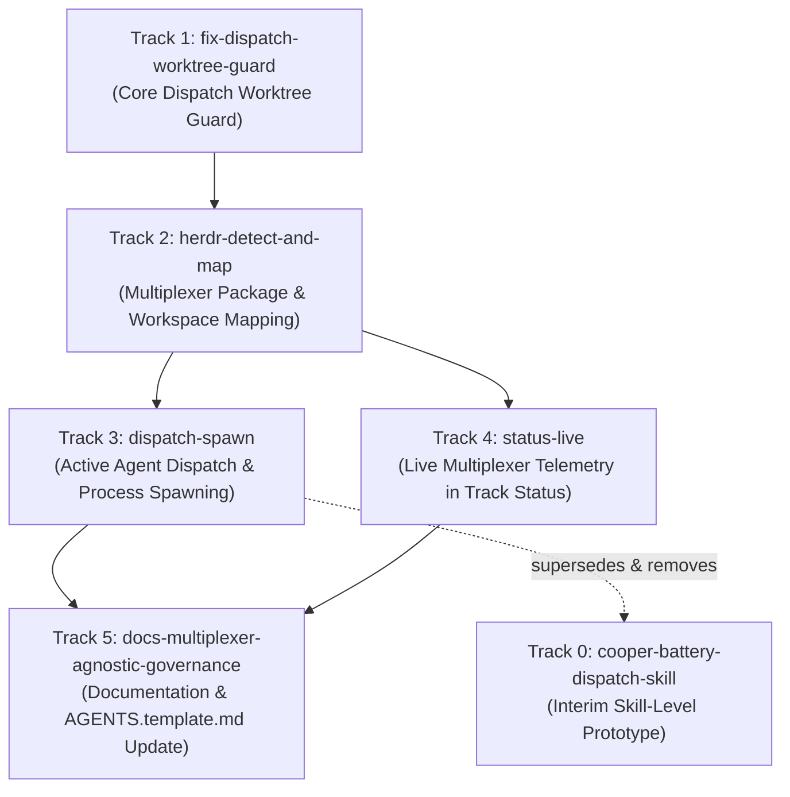

# Implementation Track Breakdown: Herdr Awareness & Multiplexer Orchestration

This document decomposes the architecture proposed in RFC `rfc-herdr-awareness` into a sequential set of concrete, independently executable Cooper tracks.

---

## Dependency Graph

---

## Track Catalog

### Track 0: `cooper-battery-dispatch-skill`
- **Scope**: Author an interim project-level Cooper skill (`.agents/skills/cooper-battery-dispatch/SKILL.md`) that codifies the immediate, client-side workflow for coordinating Herdr with Battery. The skill instructs root orchestrator agents running in Herdr (`HERDR_ENV=1`) on how to invoke `battery track dispatch`, inspect target barrel directories, open worktrees, and bootstrap child agents in target barrel worktrees without requiring any Go binary modifications. This skill is strictly an interim prototype: it is superseded and removed once Track 3 (`dispatch-spawn`) ships.
- **Dependencies**: None (usable immediately as a bridge while binary tracks are implemented).
- **Living Specs Touched**:
  - `.cooper/specs/documentation/spec.md`
- **Key Deliverables**:
  - Skill definition in `.agents/skills/cooper-battery-dispatch/SKILL.md`
  - Documentation of manual verification patterns using `herdr worktree open`, `herdr agent start`, and `herdr agent prompt`
  - Deprecation and removal plan upon completion of Track 3

---

### Track 1: `fix-dispatch-worktree-guard`
- **Scope**: Fix the fallback vulnerability in `internal/track/dispatch.go`. When dispatching a track to a barrel, if `.worktrees/<track_id>` does not exist, `seedBarrelTrack` currently falls back to seeding files directly into the barrel main checkout (`barrelAbs/.cooper/active/<track_id>`), violating Troop worktree isolation. Remove the main-checkout fallback outright. When `.worktrees/<track_id>` is missing, dispatch MUST fail for that barrel only, returning an actionable error naming `git -C <barrel> agent-start <track_id>`, while continuing dispatch to remaining barrels. When `--create-worktree` is explicitly passed, Battery runs `git agent-start <track_id>` in that barrel before seeding. Retain reading from `.cooper/active/<track_id>/` in `status` solely for backward compatibility with previously seeded tracks.
- **Dependencies**: None
- **Living Specs Touched**:
  - `.cooper/specs/track-dispatch/spec.md`
- **Key Deliverables**:
  - Outright removal of main-checkout fallback in `internal/track/dispatch.go`
  - Implementation of `--create-worktree` flag invoking `git agent-start <track_id>` in target barrels
  - Isolated per-barrel error handling ensuring failure on one barrel does not block others
  - Unit tests in `internal/track/dispatch_test.go` verifying that missing worktrees fail without creating files on main

---

### Track 2: `herdr-detect-and-map`
- **Scope**: Introduce the `internal/multiplexer` abstraction layer in Battery. Implement detection of Herdr via environment variables (`HERDR_ENV=1`), socket existence at `HERDR_SOCKET_PATH`, a resolvable `herdr` binary (`HERDR_BIN_PATH`, then `PATH`), and a preflight check executing `herdr status --json` that verifies both `server.running` and `server.compatible` evaluate to `true` (catching client/server version mismatches before any mutations). Opt-out is provided via `BATTERY_HERDR=0`. The adapter shells out to the `herdr` CLI and parses JSON responses; it branches on structured JSON `error.code` values (such as `agent_name_taken`, `invalid_agent_name`, `agent_not_ready`, `timeout`) rather than relying on exit status alone. Implement barrel-to-workspace mapping using `herdr worktree list --cwd <barrel>` to obtain the `source_workspace_id` matching the barrel checkout path. Support optional workspace label overrides in `.batteryrc.local` under `multiplexer.herdr.workspaceLabel` (labels only, never raw workspace IDs, per spec 5.2). If no workspace matches, report the barrel as unmapped without calling `herdr worktree open`, since `herdr worktree open` creates a source workspace as a side-effect unless `--create-workspace` is passed.
- **Dependencies**: Track 1
- **Living Specs Touched**:
  - `.cooper/specs/barrel-config/spec.md`
  - `.cooper/specs/track-dispatch/spec.md`
- **Key Deliverables**:
  - New package `internal/multiplexer/` with `Multiplexer` interface and Herdr CLI adapter
  - Preflight checks using `herdr status --json` validating server running and compatibility states
  - Structured error code dispatching based on JSON `error.code`
  - Barrel-to-workspace mapping via `herdr worktree list --cwd <barrel>` with source workspace resolution
  - Configuration schema support in `internal/config/` for `.batteryrc.local` `multiplexer.herdr.workspaceLabel`
  - Unit tests with mocked CLI outputs covering detection, version validation, error codes, and path resolution

---

### Track 3: `dispatch-spawn`
- **Scope**: Extend `battery track dispatch` with the `--spawn` flag. The `--spawn` flag is explicit per invocation (no automatic or interactive confirmation path) and requires a detected multiplexer, exiting non-zero before seeding if none is present. For each successfully seeded barrel worktree, Battery executes the following pipeline:
  1. Resolves the barrel workspace (Track 2). If the barrel is unmapped and `--create-workspace` was not passed, skip the barrel, record outcome `unmapped`, and report it.
  2. Opens the worktree using `herdr worktree open --cwd <barrel> --path <barrel>/.worktrees/<track_id> --label <barrel>:<track_id> --no-focus` to obtain the linked worktree workspace and its `root_pane` (MUST NOT call `herdr worktree create` and MUST NOT create additional pane splits).
  3. Inspects `herdr agent list`: if an agent already occupies that root pane, skips starting an agent, records outcome `already-running`, reports the existing agent name and state, and prints the kickoff text for manual sending.
  4. Starts an agent in the root pane via `herdr agent start <name> --kind <kind> --pane <root_pane>`. Name is `<barrel>-<short_track>` normalised to `[a-z][a-z0-9_-]{0,31}` (maximum 32 characters). On `agent_name_taken`, appends `-2`, `-3` (recorded in dispatch result, never on disk). Agent kind resolves from `--agent-kind`, then `.batteryrc.local` `multiplexer.herdr.agentKind`, then built-in default `claude` (never written to canonical `.batteryrc`).
  5. Handles startup gates: if `agent start` returns `agent_not_ready` (indicating the agent is waiting at a folder-trust or login dialog), reports the barrel as waiting for the operator and waits via `herdr agent wait <name> --until idle --timeout <spawn-timeout>` (default 10 minutes, configurable via `--spawn-timeout`). If `idle` is reached within the timeout, proceeds to step 6. On timeout, records outcome `waiting-timed-out`, reports it, and prints the kickoff text without sending it. Battery MUST NOT send any keys or inputs to gated agents.
  6. Submits the fixed kickoff prompt template once via `herdr agent prompt <name> <kickoff>` without `--wait`, and records outcome `prompted`.
  7. Deprecates and removes Track 0 interim skill.
- **Dependencies**: Track 1, Track 2
- **Living Specs Touched**:
  - `.cooper/specs/track-dispatch/spec.md`
- **Key Deliverables**:
  - Flags `--spawn`, `--agent-kind`, and `--spawn-timeout` added to `battery track dispatch`
  - Process orchestration in `internal/track/spawn.go` executing worktree opening, agent occupancy check, startup gate waiting, and kickoff prompt submission
  - Structured per-barrel dispatch reporting tracking outcomes: `prompted`, `waiting-timed-out`, `already-running`, `unmapped`
  - Invariant enforcement: no auto-approvals, no sending keys to gated agents, no closing workspaces or stopping servers
  - Comprehensive unit and integration tests covering:
    - Normal end-to-end spawn and prompt delivery (Scenario 5.4)
    - Agent waiting at startup gates with successful idle resumption and timeout fallback (Scenario 5.4a)
    - Re-running spawn against already occupied root panes (Scenario 5.4b)
    - Structured error code branching without blind retries (Scenario 5.4c)

---

### Track 4: `status-live`
- **Scope**: Enhance `battery track status <track_id>` and `battery track list` to include live agent telemetry when `--live` is explicitly passed and a multiplexer is detected. Live state is only fetched when `--live` is supplied; it is not implied by `HERDR_ENV=1`. Battery calls `herdr agent list` once per status invocation and matches agents to barrels by checking if the agent `cwd` or `foreground_cwd` lies under `<barrel>/.worktrees/<track_id>` (not by matching agent names). The report outputs agent name, kind, and lifecycle state (`idle`, `working`, `blocked`, `done`, `unknown`), or `no agent` when none matches. If a multiplexer is not detected, `--live` prints standard file-based status, notes that live state is unavailable, and exits zero. Extend MCP tool `battery_track_status` with `live: true` parameter, preserving the canonical MCP resource URI `battery://tracks/{track_id}`.
- **Dependencies**: Track 2
- **Living Specs Touched**:
  - `.cooper/specs/track-dispatch/spec.md`
- **Key Deliverables**:
  - Telemetry aggregator in `internal/track/status.go` invoking `herdr agent list` once per status run
  - Worktree directory prefix matching for `cwd` and `foreground_cwd`
  - CLI table formatting with live state indicators
  - MCP tool parameter `live` on `battery_track_status` targeting `battery://tracks/{track_id}`
  - Tests verifying status aggregation across active, idle, blocked, and unmapped barrels

---

### Track 5: `docs-multiplexer-agnostic-governance`
- **Scope**: Update documentation and agent workflow guidelines across the project. Revise `AGENTS.md` and `AGENTS.template.md` to recommend `battery track dispatch --spawn` when a multiplexer is reported by Battery, while omitting any multiplexer-specific commands to keep guidance strictly tool-agnostic. Update VitePress documentation to detail the spec-plane versus execution-plane division, the `internal/multiplexer` abstraction, environment variable opt-out (`BATTERY_HERDR=0`), and `.batteryrc.local` workspace label overrides.
- **Dependencies**: Track 3, Track 4
- **Living Specs Touched**:
  - `.cooper/specs/documentation/spec.md`
  - `.cooper/specs/track-dispatch/spec.md`
- **Key Deliverables**:
  - Updated `AGENTS.template.md` with multiplexer-assisted dispatch notes
  - VitePress documentation updates covering multiplexer integration and configuration
  - Invariant documentation: non-multiplexer environments retain full functionality
