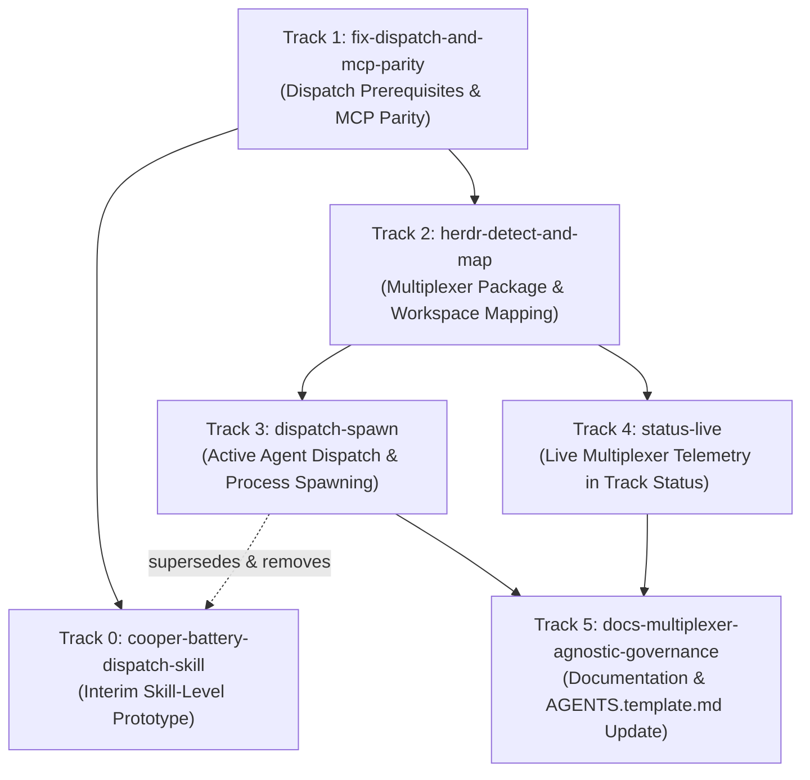

# Implementation Track Breakdown: Herdr Awareness & Multiplexer Orchestration

This document decomposes the architecture proposed in RFC `rfc-herdr-awareness` into a sequential set of concrete, independently executable Cooper tracks.

---

## Dependency Graph

---

## Track Catalog

### Track 0: `cooper-battery-dispatch-skill`
- **Scope**: Author an interim project-level Cooper skill (`.agents/skills/cooper-battery-dispatch/SKILL.md`) that codifies the immediate, client-side workflow for coordinating Herdr with Battery. The skill instructs root orchestrator agents running in Herdr (`HERDR_ENV=1`) on how to invoke `battery track dispatch`, inspect target barrel directories, open worktrees, and bootstrap child agents in target barrel worktrees without requiring any Go binary modifications. This skill is strictly an interim prototype: it requires Track 1 so dispatch copies real spec deltas instead of placeholder stubs and verifies capability mappings before automating barrel agent kickoff, and is superseded and removed once Track 3 (`dispatch-spawn`) ships.
- **Dependencies**: Track 1 (ensures dispatch copies real root spec deltas rather than placeholder stubs and validates capability mappings before the skill automates barrel agent kickoff).
- **Living Specs Touched**:
  - `.cooper/specs/documentation/spec.md`
- **Key Deliverables**:
  - Skill definition in `.agents/skills/cooper-battery-dispatch/SKILL.md`
  - Documentation of manual verification patterns using `herdr worktree open`, `herdr agent start`, and `herdr agent prompt`
  - Deprecation and removal plan upon completion of Track 3

---

### Track 1: `fix-dispatch-and-mcp-parity`
- **Scope**: Implement the dispatch prerequisites and MCP parity described in RFC Section 2.1 (a through f). This track ships before multiplexer integration and does not depend on Herdr:
  1. **Worktree guard**: Remove the fallback in `internal/track/dispatch.go` that writes to a barrel's main checkout (`<barrel>/.cooper/active/<track_id>/`). When `.worktrees/<track_id>` is missing, dispatch fails for that barrel with an error naming `git -C <barrel> agent-start <track_id>`, while continuing dispatch to remaining barrels.
  2. **Worktree auto-creation**: With `--create-worktree`, Battery runs `git fetch origin main` concurrently across all barrels needing a worktree, each limited to 20 seconds (a timed-out fetch counts as a failure, producing a warning that the worktree is based on local `main`), then runs `git agent-start <track_id>`. If `agent-start` exits non-zero (including when Troop is not installed, whether as an alias or an executable), that barrel fails with the Git output and nothing is seeded. Seeded files remain untracked.
  3. **Map capabilities to barrels**: The root track's `metadata.json` gains `barrel_capabilities`, mapping each barrel to its list of capabilities. Set via repeatable `--map <barrel>=<cap>[,<cap>...]` on `battery track init` and `barrel_capabilities` on MCP `battery_init_track`. Dispatch reads it; a barrel lacking an entry fails with an error naming the missing entry; a track without `barrel_capabilities` fails before touching any barrel. The track-ID fallback is removed.
  4. **Copy real spec deltas**: Replace placeholder spec delta generation in `seedBarrelTrack` with logic that copies `<root>/.cooper/active/<track_id>/spec-deltas/<capability>/spec.md` for each mapped capability. If a mapped capability lacks a root delta, dispatch fails for that barrel and names the missing file. No placeholder content is ever written.
  5. **Re-dispatch drift reporting**: When a barrel already has the track, dispatch compares each mapped capability's barrel delta with its root delta: `up-to-date` (identical), `added` (newly mapped root delta copied into barrel), `stale` (differs from root delta, left unmodified without `--force`), and `orphaned` (barrel delta no longer mapped, reported and preserved). Any barrel with a `stale` delta receives outcome `stale`. With `--force`, `stale` deltas are overwritten and reported as `updated`.
  6. **Exit status**: Update `runTrackDispatch` in `cmd/track.go` to return an error when any barrel fails or has outcome `stale`, causing dispatch to exit with status 1 on partial failure or stale deltas, and exit 0 only when all barrels succeed.
  7. **MCP dispatch parity**: Extend the `battery_dispatch_track` tool in `internal/mcp/tools.go` with optional boolean parameter `create_worktree` (default `false`). Return structured per-barrel results with delta states and error details, and mark the tool result as an error on failure. Extend `battery_init_track` with `barrel_capabilities`. Correct the dispatch description in the `plan_multi_barrel_track` MCP prompt (`internal/mcp/prompts.go`). Enforce that MCP never spawns agents or invokes a multiplexer.
- **Dependencies**: None
- **Living Specs Touched**:
  - `.cooper/specs/track-dispatch/spec.md`
  - `.cooper/specs/mcp-server/spec.md`
- **Key Deliverables**:
  - Removal of main-checkout fallback in `internal/track/dispatch.go`
  - Implementation of `--create-worktree` with concurrent 20-second `git fetch origin main` preflight
  - Schema extension for `barrel_capabilities` in `metadata.json`, `battery track init --map`, and MCP `battery_init_track`
  - Root spec delta copying engine with missing-delta validation and placeholder elimination
  - Delta comparison engine for `up-to-date`, `added`, `stale`, `updated`, and `orphaned` states
  - Non-zero exit status (code 1) handling in `cmd/track.go` on failure or stale deltas
  - MCP schema updates in `internal/mcp/tools.go` and prompt correction in `internal/mcp/prompts.go`
  - Comprehensive unit tests covering worktree validation, capability mapping, delta copying, drift states, and MCP tool invocations (Scenarios 1.2, 2.1 to 2.10, and MCP Scenarios 2.4, 2.9, 4.3)

---

### Track 2: `herdr-detect-and-map`
- **Scope**: Implement the `internal/multiplexer` abstraction package, runtime environment detection, and status integration per RFC Sections 2.2 and 2.3:
  1. **Interface definition**: Create `internal/multiplexer` defining the `Multiplexer` interface (`Name()`, `SourceWorkspace()`, `OpenWorktree()`, `StartAgent()`, `WaitReady()`, `PromptAgent()`, `ListAgents()`). `StartAgent` accepts no agent arguments, preventing permission bypass flags.
  2. **Lazy detection**: Run detection only for commands requiring it (`battery track dispatch --spawn`, `battery track status --live`, and `battery status`). Detect Herdr when `BATTERY_HERDR != "0"`, `HERDR_ENV == "1"`, `HERDR_SOCKET_PATH` exists as a socket, `herdr` binary resolves (`HERDR_BIN_PATH` then `PATH`), and `herdr status --json` reports both `server.running` and `server.compatible` as `true`. Select the no-op backend otherwise.
  3. **Structured error code dispatching**: The Herdr CLI adapter parses JSON responses and branches on `error.code` (`agent_name_taken`, `invalid_agent_name`, `agent_not_ready`, `agent_blocked`, `timeout`), treating any unrecognized code as outcome `failed`. Support Battery-defined codes `agent_not_detected` (agent start timed out and no process in pane) and `agent_exited` (gated agent disappeared during wait).
  4. **Path canonicalisation and source workspace mapping**: Canonicalise all paths using `filepath.EvalSymlinks` and `filepath.Clean`. Match paths by path component boundaries (never substring prefix matching) to prevent `.worktrees/t10` matching `.worktrees/t1`. Implement `SourceWorkspace` via `herdr worktree list --cwd <barrel>` checking `source.source_workspace_id`.
  5. **No configuration persistence**: No multiplexer or session IDs are ever written to disk. No `.batteryrc.local` keys are added; agent kind is configured via `--agent-kind` CLI flag or `BATTERY_AGENT_KIND` environment variable.
  6. **Status integration**: Update `battery status` to print the detected multiplexer line naming the multiplexer, its server version, and whether each barrel has a source workspace open (Scenario 5.4 in `barrel-config`), or a single line stating no multiplexer was detected.
- **Dependencies**: Track 1
- **Living Specs Touched**:
  - `.cooper/specs/track-dispatch/spec.md`
  - `.cooper/specs/barrel-config/spec.md`
- **Key Deliverables**:
  - `internal/multiplexer` package with clean interface and Herdr CLI adapter
  - Lazy detection engine evaluating environment variables and `herdr status --json`
  - Robust path canonicalisation using `filepath.EvalSymlinks` and component-based matching
  - Source workspace resolver querying `herdr worktree list`
  - Multiplexer status reporting line added to `battery status`
  - Unit tests with mocked CLI outputs covering detection, path canonicalisation, symlink evaluation, error codes, and status output (Scenarios 5.1 to 5.4, and barrel-config Scenario 5.4)

---

### Track 3: `dispatch-spawn`
- **Scope**: Implement active agent dispatch via `battery track dispatch --spawn` per RFC Section 2.4. `--spawn` requires a detected multiplexer, exiting non-zero before seeding if none is present:
  1. **Agent naming rule**: Apply one rule to the whole name: take `<barrel>-<track_id>`, lowercase it, replace each character outside `[a-z0-9_-]` with `-`, collapse repeated `-`, and prefix `a` if it does not start with a letter. Truncate to 32 characters. On `agent_name_taken`, truncate to 30 characters and append `-2`, then `-3`, up to `-9`. The final name is shown in the output and not written to disk (the name is for display only; after launch, Battery addresses agents by their root pane ID, never by name).
  2. **Phase 1 pipeline (prepare each barrel in turn)**:
     - Run seeding (Track 1). If seeding fails, outcome is `failed`. If any mapped delta is `stale`, outcome is `stale`, which blocks spawn for that barrel.
     - Resolve source workspace (Track 2). If unmapped and `--create-workspace` was not passed, outcome is `unmapped`.
     - Open worktree: Execute `herdr worktree open --workspace <source_workspace_id> --path <barrel>/.worktrees/<track_id> --label <barrel>:<track_id> --no-focus` (or `--cwd <barrel>` when `--create-workspace` is passed) to obtain the linked workspace `root_pane`.
     - Check live agents: Inspect `herdr agent list`. If any live agent has its canonicalised `cwd` under the worktree in any pane, record outcome `already-running` with the agent name and state, and skip launch.
  3. **Phase 2 pipeline (start agents concurrently)**:
     - For every pending barrel, execute `herdr agent start <name> --kind <kind> --pane <root_pane> --timeout 60000` concurrently with no agent arguments. Resolve `<kind>` from `--agent-kind`, `BATTERY_AGENT_KIND`, then `claude`.
     - If ready (`agent_started`), proceed to Phase 3.
     - If `agent_not_ready` is returned immediately (agent held at a folder-trust or login startup dialog), record outcome `waiting-for-operator`. Never answer the dialog.
     - If `timeout` occurs, query `herdr agent get <root_pane>`. If an agent is detected in the pane, record outcome `waiting-for-operator`. If no agent is detected (binary missing, crashed, or never started), record outcome `failed` with code `agent_not_detected`.
     - If the root pane is not at a shell prompt, record outcome `failed` with Herdr's code.
  4. **Phase 3 pipeline (send kickoffs)**:
     - For each ready agent, submit the fixed kickoff template once via `herdr agent prompt <root_pane> <kickoff>` without `--wait`. If rejected with `agent_blocked`, record outcome `waiting-for-operator`. Otherwise record outcome `prompted`.
  5. **Phase 4 pipeline (only with `--wait-gates`)**:
     - Wait concurrently on all `waiting-for-operator` agents via `herdr agent wait <root_pane> --until idle --until done --until working` for up to `--gate-timeout` (default 10 minutes).
     - If `idle` or `done` first, send kickoff and record outcome `prompted`.
     - If `working` first, send nothing, print the kickoff text asking the operator to verify, and record outcome `operator-active` (preventing double kickoff).
     - If agent exits during wait, record outcome `failed` with code `agent_exited`.
     - If timeout expires, outcome remains `waiting-for-operator`.
  6. **Output & Kickoff Text**:
     - Output one block per barrel: workspace label, agent name, kind, outcome (`prompted`, `waiting-for-operator`, `already-running`, `operator-active`, `unmapped`, `stale`, `failed`), and error code if applicable.
     - Print the exact kickoff text for barrels ending `waiting-for-operator` or `operator-active`. Under `--wait-gates`, print kickoff text only after Phase 4 ends.
  7. **Exit status**:
     - Exit 0 if every barrel is `prompted` or `already-running`.
     - Exit 3 if no barrel `failed`, `stale`, or `unmapped`, but at least one barrel is `waiting-for-operator` or `operator-active`.
     - Exit 1 if at least one barrel `failed`, `stale`, or `unmapped`.
  8. **Skill deprecation**: Remove Track 0 interim skill (`.agents/skills/cooper-battery-dispatch/SKILL.md`).
- **Dependencies**: Track 1, Track 2
- **Living Specs Touched**:
  - `.cooper/specs/track-dispatch/spec.md`
- **Key Deliverables**:
  - Flags `--spawn`, `--create-workspace`, `--wait-gates`, `--gate-timeout`, and `--agent-kind` added to `battery track dispatch`
  - Four-phase concurrent spawn pipeline in `internal/track/spawn.go`
  - Whole-name agent normalisation engine matching `[a-z][a-z0-9_-]{0,31}`
  - Structured per-barrel reporting with outcomes (`prompted`, `waiting-for-operator`, `already-running`, `operator-active`, `unmapped`, `stale`, `failed`) and exit codes 0, 1, 3
  - Removal of Track 0 interim skill
  - Test suite covering all spawn edge cases, concurrent launches, gate waiting, and error codes (Scenarios 5.5 through 5.19)

---

### Track 4: `status-live`
- **Scope**: Implement live agent telemetry in `battery track status <track_id> --live` per RFC Section 2.5:
  1. **CLI only**: Query live multiplexer telemetry solely when `--live` is explicitly passed to the CLI. The MCP server does not expose live status.
  2. **Agent mapping**: Call `herdr agent list` once per status invocation. Match each barrel to live agents whose canonical `cwd` (resolved via `filepath.EvalSymlinks`) is under that barrel's canonical worktree path, compared by path component boundaries. `foreground_cwd` is ignored.
  3. **Multi-line status rendering**: Add an `Agent` line to each barrel block displaying the agent name, kind, and lifecycle state (`idle`, `working`, `blocked`, `done`, `unknown`), or `Agent      : none` when no agent matches. If multiple agents match, list each on a separate line.
  4. **Fallback handling**: If no multiplexer is detected, print standard file-based status, note that live state is unavailable, and exit 0.
- **Dependencies**: Track 2
- **Living Specs Touched**:
  - `.cooper/specs/track-dispatch/spec.md`
- **Key Deliverables**:
  - Telemetry aggregator in `internal/track/status.go` invoking `herdr agent list` once
  - Canonical path component matching engine for agent `cwd`
  - Multi-line status output formatting with `Agent` line
  - Zero exit code handling for no-multiplexer fallback
  - Unit tests verifying live status matching across single, multiple, idle, working, blocked, and unmapped agents (Scenarios 3.2 through 3.5)

---

### Track 5: `docs-multiplexer-agnostic-governance`
- **Scope**: Update project documentation and agent guidance per RFC Section 2.7:
  1. **Root agent guidance**: Update `AGENTS.template.md` to include multiplexer-agnostic guidance in the dispatch workflow: "If Battery reports a multiplexer, prefer `battery track dispatch --spawn` so barrel sessions start in the track worktree." Do not include any tool-specific Herdr commands.
  2. **Documentation site**: Update VitePress documentation to detail `battery track init --map`, `battery track dispatch` flags (`--force`, `--create-worktree`, `--spawn`, `--create-workspace`, `--wait-gates`, `--gate-timeout`, `--agent-kind`), status flag (`--live`), environment variables (`BATTERY_HERDR`, `BATTERY_AGENT_KIND`), delta states (`up-to-date`, `added`, `stale`, `updated`, `orphaned`), outcomes table, and exit status table (0, 1, 3).
  3. **Operator authority documentation**: Document the authority boundaries, specifying that Battery never answers dialogs or approvals, never closes user workspaces or panes, and leaves gate resolution to the human operator.
- **Dependencies**: Track 3, Track 4
- **Living Specs Touched**:
  - `.cooper/specs/documentation/spec.md`
  - `.cooper/specs/track-dispatch/spec.md`
- **Key Deliverables**:
  - Updated `AGENTS.template.md` with agnostic dispatch recommendations
  - Complete documentation pages covering initialization mapping, dispatch, spawn, live status, environment variables, outcomes, and exit codes
  - Explicit operator authority and safety invariant sections in documentation
